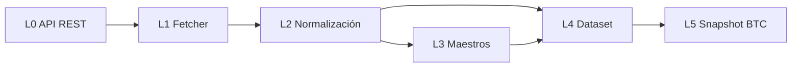

# Diccionario de datos y linaje — BinanceDataScience

> Documento técnico. Arquitectura: `proceso_arquitectura_binance.md`. Visión de negocio: `ingesta_datos.md`.

## 1. Cómo usar este documento

- **Sección 3:** campos que entrega cada fuente y cuáles se descartan.
- **Sección 5:** qué contiene cada archivo y qué significa cada columna.
- **Sección 6:** tránsito de cada campo por las fases del pipeline.
- **Sección 7:** campos creados, renombrados y descartados.
- **Sección 9:** reglas de calidad y desviaciones conocidas.

## 2. Convenciones

| Convención | Significado |
|---|---|
| `L0` | Fuente externa: API REST de Binance. |
| `L1` | Extracción: `fetcher_02.py`. |
| `L2` | Normalización: `data_consolidator_03.py`. |
| `L3` | Maestro persistido: funding o sentimiento. |
| `L4` | Dataset analítico consolidado. |
| `L5` | Snapshot compacto de BTC para IA. |
| `int64` | Entero de 64 bits; timestamps y conteos. |
| `float` | Decimal; precios, volúmenes, ratios y tasas. |
| `string` | Texto; símbolos, fechas serializadas y enumeraciones. |
| `ms` | Milisegundos Unix en UTC. |
| `fecha_utc` | Fecha UTC naive, sin offset. |
| `fecha_local` | Fecha en `America/Mexico_City`, con offset. |
| `NaN` | Dato no disponible; en CSV se escribe vacío. |
| `USD` | Sinónimo de USDT en los símbolos USDⓈ-M. |

## 3. Fuentes y campos crudos

### 3.1 Klines

Endpoint: `/fapi/v1/klines` mediante `futures_historical_klines()`.

| Posición | Campo API | Uso | Nombre interno |
|---:|---|---|---|
| 0 | `openTime` | Usado | `open_time_ms` |
| 1 | `open` | Usado | `open` |
| 2 | `high` | Usado | `high` |
| 3 | `low` | Usado | `low` |
| 4 | `close` | Usado | `close` |
| 5 | `volume` | Usado | `volume` |
| 6 | `closeTime` | Usado | `close_time_ms` |
| 7 | `quoteAssetVolume` | Usado | `quote_asset_volume` |
| 8 | `numberOfTrades` | Usado | `number_of_trades` |
| 9 | `takerBuyBaseAssetVolume` | Usado | `taker_buy_base_asset_volume` |
| 10 | `takerBuyQuoteAssetVolume` | Usado | `taker_buy_quote_asset_volume` |
| 11 | `ignore` | **Descartado** | — |

El flujo automático descarta `k[11]`. La descarga manual de Vision (`recovery_vision_06.py`) sí conserva esa columna en su CSV crudo, fuera del pipeline.

### 3.2 Funding

Endpoint: `/fapi/v1/fundingRate` mediante `futures_funding_rate()`.

| Campo API | Uso | Destino | Nota |
|---|---|---|---|
| `symbol` | **Descartado** | — | Se reemplaza por el símbolo del pipeline. |
| `fundingTime` | Usado | Maestro | Clave temporal. |
| `fundingRate` | Usado | Maestro y dataset | Tasa decimal por periodo. |
| `markPrice` | Usado | Maestro | No pasa al dataset. |
| `rateType` | Opcional | Maestro | Puede no existir; no pasa al dataset. |

### 3.3 Sentimiento

Endpoints: `/futures/data/*`.

| Endpoint | Campo API | Uso | Destino |
|---|---|---|---|
| `openInterestHist` | `symbol` | **Descartado** | — |
| | `sumOpenInterest` | Usado | `oi_sum_open_interest` |
| | `sumOpenInterestValue` | Usado | `oi_value_usd` |
| | `CMCCirculatingSupply` | Usado | `oi_cmc_circulating_supply` |
| | `timestamp` | Usado | `timestamp` |
| `globalLongShortAccountRatio` | `symbol` | **Descartado** | — |
| | `longAccount` | Usado | `global_ls_long_account` |
| | `shortAccount` | Usado | `global_ls_short_account` |
| | `longShortRatio` | Usado | `global_ls_ratio` |
| | `timestamp` | Usado | `timestamp` |
| `topLongShortAccountRatio` | `symbol` | **Descartado** | — |
| | `longAccount` | Usado | `top_accounts_long_account` |
| | `shortAccount` | Usado | `top_accounts_short_account` |
| | `longShortRatio` | Usado | `top_accounts_ratio` |
| | `timestamp` | Usado | `timestamp` |
| `topLongShortPositionRatio` | `symbol` | **Descartado** | — |
| | `longAccount` | Usado | `top_positions_long_account` |
| | `shortAccount` | Usado | `top_positions_short_account` |
| | `longShortRatio` | Usado | `top_positions_ratio` |
| | `timestamp` | Usado | `timestamp` |
| `takerlongshortRatio` | `symbol` | **Descartado** | — |
| | `buySellRatio` | Usado | `taker_buy_sell_ratio` |
| | `buyVol` | Usado | `taker_buy_vol` |
| | `sellVol` | Usado | `taker_sell_vol` |
| | `timestamp` | Usado | `timestamp` |

Cualquier campo que la API agregue y no aparezca en estas tablas se descarta al reindexar al esquema interno.

## 4. Fases del linaje

| Fase | Artefacto | Qué ocurre |
|---|---|---|
| L0 | Respuesta JSON o arreglo de Binance | Datos crudos en memoria. |
| L1 | Diccionarios internos | Nombres y estructura uniforme. |
| L2 | DataFrames normalizados | Tipos, deduplicación y orden. |
| L3 | `funding_rates_master.csv`, `sentimiento_<tf>_master.csv` | Acumulación persistente. |
| L4 | `dataset_analisis_<tf>.csv` | Cruces, metadatos y derivadas. |
| L5 | `outputs/btcusdt/data_ddmmyy_<minutos>.csv` | Proyección de 17 columnas y recorte a las últimas 144, 96 o 28 velas. |

## 5. Archivos y esquemas

### 5.1 Inventario

En `outputs/data/<símbolo>/consolidado/` se generan 7 archivos por cada símbolo (`BNBUSDT`, `ETHUSDT`, `XRPUSDT`, `SOLUSDT`, `BTCUSDT`):

| Archivo | Columnas | Clave lógica | Frecuencia |
|---|---:|---|---|
| `funding_rates_master.csv` | 9 | `(symbol, fundingTime)` | Cada 8 h |
| `sentimiento_5m_master.csv` | 21 | `(symbol, timestamp)` | 5 m |
| `sentimiento_15m_master.csv` | 21 | `(symbol, timestamp)` | 15 m |
| `sentimiento_12h_master.csv` | 21 | `(symbol, timestamp)` | 12 h |
| `dataset_analisis_5m.csv` | 38 | `(symbol, open_time_ms)` | 5 m |
| `dataset_analisis_15m.csv` | 38 | `(symbol, open_time_ms)` | 15 m |
| `dataset_analisis_12h.csv` | 38 | `(symbol, open_time_ms)` | 12 h |

Los directorios usan el símbolo en minúsculas (`btcusdt`, `ethusdt`, …). Estos archivos conservan la historia completa.

En `outputs/btcusdt/` se generan solo snapshots de BTC:

| Archivo | Timeframe | Columnas | Filas máximas |
|---|---|---:|---:|
| `data_ddmmyy_5.csv` | 5m | 17 | 144 |
| `data_ddmmyy_15.csv` | 15m | 17 | 96 |
| `data_ddmmyy_720.csv` | 12h | 17 | 28 |

- `ddmmyy` es la fecha local de México del momento de exportación.
- El archivo se sobrescribe si se vuelve a exportar el mismo día.
- Al inicio de la exportación se eliminan los snapshots previos de los tres timeframes.
- La lectura usa solo la cola del dataset.
- No se genera archivo de resumen; los metadatos solo van al log.

### 5.2 `funding_rates_master.csv`

| Campo | Tipo | Unidad | Significado | Origen |
|---|---|---|---|---|
| `symbol` | string | — | Símbolo en mayúsculas. | Pipeline |
| `fecha_utc` | timestamp naive | UTC | Fecha del pago. | `fundingTime` |
| `fecha_local` | timestamp con offset | México | Fecha local del pago. | `fundingTime` |
| `fundingTime` | int64 | ms | Momento del pago. | API |
| `fundingRate` | float | tasa decimal | Tasa aplicada; `0.0001` = `0.01 %`. | API |
| `markPrice` | float | precio | Precio mark en el pago. | API |
| `rateType` | string | — | Tipo de tasa, si existe. | API |
| `origen_datos` | string | — | Constante `api_funding`. | Pipeline |
| `fecha_procesamiento` | timestamp con offset | México | Marca de la primera corrida que escribió la fila. | Pipeline |

### 5.3 `sentimiento_<tf>_master.csv`

| Campo | Tipo | Unidad | Significado | Origen |
|---|---|---|---|---|
| `symbol` | string | — | Símbolo en mayúsculas. | Pipeline |
| `fecha_utc` | timestamp naive | UTC | Fecha de la observación. | `timestamp` |
| `fecha_local` | timestamp con offset | México | Fecha local. | `timestamp` |
| `oi_sum_open_interest` | float | activo base | Interés abierto total. | `sumOpenInterest` |
| `oi_value_usd` | float | USD/USDT | Valor nocional del OI. | `sumOpenInterestValue` |
| `oi_cmc_circulating_supply` | float | tokens | Oferta circulante CMC. | `CMCCirculatingSupply` |
| `timestamp` | int64 | ms | Clave temporal. | API |
| `global_ls_long_account` | float | proporción | Cuentas globales en largo. | `longAccount` |
| `global_ls_ratio` | float | ratio | Ratio global largo/corto. | `longShortRatio` |
| `global_ls_short_account` | float | proporción | Cuentas globales en corto. | `shortAccount` |
| `top_accounts_long_account` | float | proporción | Cuentas top en largo. | `longAccount` |
| `top_accounts_ratio` | float | ratio | Ratio de cuentas top. | `longShortRatio` |
| `top_accounts_short_account` | float | proporción | Cuentas top en corto. | `shortAccount` |
| `top_positions_long_account` | float | proporción | Posiciones top en largo. | `longAccount` |
| `top_positions_ratio` | float | ratio | Ratio de posiciones top. | `longShortRatio` |
| `top_positions_short_account` | float | proporción | Posiciones top en corto. | `shortAccount` |
| `taker_buy_sell_ratio` | float | ratio | Ratio taker comprador/vendedor. | `buySellRatio` |
| `taker_sell_vol` | float | activo base | Volumen taker vendedor. | `sellVol` |
| `taker_buy_vol` | float | activo base | Volumen taker comprador. | `buyVol` |
| `origen_datos` | string | — | Constante `api_sentimiento`. | Pipeline |
| `fecha_procesamiento` | timestamp con offset | México | Marca de la primera corrida que escribió la fila. | Pipeline |

### 5.4 `dataset_analisis_<tf>.csv`

#### Klines y metadatos

| Campo | Tipo | Unidad | Significado | Origen |
|---|---|---|---|---|
| `symbol` | string | — | Símbolo en mayúsculas. | Pipeline |
| `fecha_utc` | timestamp naive | UTC | Apertura de la vela. | `open_time_ms` |
| `fecha_local` | timestamp con offset | México | Apertura local. | `open_time_ms` |
| `open_time_ms` | int64 | ms | Apertura; clave. | `k[0]` |
| `open` | float | precio | Apertura. | `k[1]` |
| `high` | float | precio | Máximo. | `k[2]` |
| `low` | float | precio | Mínimo. | `k[3]` |
| `close` | float | precio | Cierre. | `k[4]` |
| `volume` | float | activo base | Volumen base. | `k[5]` |
| `close_time_ms` | int64 | ms | Cierre de la vela. | `k[6]` |
| `quote_asset_volume` | float | USD/USDT | Volumen en cotización. | `k[7]` |
| `number_of_trades` | int64 | conteo | Número de operaciones. | `k[8]` |
| `taker_buy_base_asset_volume` | float | activo base | Compra taker en base. | `k[9]` |
| `taker_buy_quote_asset_volume` | float | USD/USDT | Compra taker en cotización. | `k[10]` |
| `origen_datos` | string | — | Constante `api_rest`. | Pipeline |
| `fecha_procesamiento` | timestamp con offset | México | Marca de la primera corrida que escribió la fila. | Pipeline |

#### Derivadas

| Campo | Tipo | Unidad | Significado | Fórmula |
|---|---|---|---|---|
| `retorno_pct` | float | porcentaje | Retorno de la vela. | `(close / open - 1) * 100` |
| `rango_hl_pct` | float | porcentaje | Rango máximo/mínimo. | `(high / low - 1) * 100` |
| `taker_sell_quote_asset_volume` | float | USD/USDT | Venta taker derivada. | `quote_asset_volume - taker_buy_quote_asset_volume` |
| `delta_vol_total_usd` | float | USD/USDT | Cambio de volumen total. | `quote_asset_volume.diff()` |
| `delta_vol_comprador_usd` | float | USD/USDT | Cambio de compra taker. | `taker_buy_quote_asset_volume.diff()` |
| `delta_vol_vendedor_usd` | float | USD/USDT | Cambio de venta taker. | `taker_sell_quote_asset_volume.diff()` |

#### Sentimiento

| Campo | Tipo | Unidad | Significado | Origen |
|---|---|---|---|---|
| `oi_sum_open_interest` | float | activo base | Interés abierto. | `sumOpenInterest` |
| `oi_value_usd` | float | USD/USDT | Valor nocional del OI. | `sumOpenInterestValue` |
| `oi_cmc_circulating_supply` | float | tokens | Oferta circulante CMC. | `CMCCirculatingSupply` |
| `global_ls_long_account` | float | proporción | Cuentas globales en largo. | `longAccount` |
| `global_ls_ratio` | float | ratio | Ratio global. | `longShortRatio` |
| `global_ls_short_account` | float | proporción | Cuentas globales en corto. | `shortAccount` |
| `top_accounts_long_account` | float | proporción | Cuentas top en largo. | `longAccount` |
| `top_accounts_ratio` | float | ratio | Ratio de cuentas top. | `longShortRatio` |
| `top_accounts_short_account` | float | proporción | Cuentas top en corto. | `shortAccount` |
| `top_positions_long_account` | float | proporción | Posiciones top en largo. | `longAccount` |
| `top_positions_ratio` | float | ratio | Ratio de posiciones top. | `longShortRatio` |
| `top_positions_short_account` | float | proporción | Posiciones top en corto. | `shortAccount` |
| `taker_buy_sell_ratio` | float | ratio | Ratio taker. | `buySellRatio` |
| `taker_sell_vol` | float | activo base | Venta taker. | `sellVol` |
| `taker_buy_vol` | float | activo base | Compra taker. | `buyVol` |

#### Funding

| Campo | Tipo | Unidad | Significado | Origen |
|---|---|---|---|---|
| `fundingRate` | float | tasa decimal | Última tasa vigente al abrir la vela. | `fundingRate` con `merge_asof` |

### 5.5 Snapshot `data_ddmmyy_<minutos>.csv`

| Campo | Origen | Significado |
|---|---|---|
| `fecha_local` | Dataset | Referencia temporal. |
| `open` | Dataset | Apertura. |
| `high` | Dataset | Máximo. |
| `low` | Dataset | Mínimo. |
| `close` | Dataset | Cierre. |
| `volume` | Dataset | Volumen base. |
| `quote_asset_volume` | Dataset | Volumen cotización. |
| `number_of_trades` | Dataset | Operaciones. |
| `taker_buy_quote_asset_volume` | Dataset | Compra taker. |
| `retorno_pct` | Derivada | Retorno. |
| `rango_hl_pct` | Derivada | Rango. |
| `oi_value_usd` | Sentimiento | Valor del OI. |
| `global_ls_ratio` | Sentimiento | Ratio global. |
| `top_accounts_ratio` | Sentimiento | Ratio de cuentas top. |
| `top_positions_ratio` | Sentimiento | Ratio de posiciones top. |
| `taker_buy_sell_ratio` | Sentimiento | Ratio taker. |
| `fundingRate` | Funding | Última tasa vigente. |

El snapshot es una proyección directa del dataset, no un muestreo. Contiene las últimas 144 velas en 5m, 96 en 15m y 28 en 12h. Si el dataset tiene menos filas, el snapshot tendrá menos. Solo se lee la cola del archivo.

## 6. Matriz de tránsito por fase

### 6.1 Klines y derivadas

| Campo | L0 Origen | L1 Fetcher | L2 Normalización | L3 Maestro | L4 Dataset | L5 Snapshot | Estado |
|---|---|---|---|---|---|---|---|
| `open_time_ms` | `k[0]` | `open_time_ms` | `int64` | — | Sí | No | Clave |
| `open` | `k[1]` | `open` | `float` | — | Sí | Sí | Usado |
| `high` | `k[2]` | `high` | `float` | — | Sí | Sí | Usado |
| `low` | `k[3]` | `low` | `float` | — | Sí | Sí | Usado |
| `close` | `k[4]` | `close` | `float` | — | Sí | Sí | Usado |
| `volume` | `k[5]` | `volume` | `float` | — | Sí | Sí | Usado |
| `close_time_ms` | `k[6]` | `close_time_ms` | `int64` | — | Sí | No | Descartado en snapshot |
| `quote_asset_volume` | `k[7]` | `quote_asset_volume` | `float` | — | Sí | Sí | Usado |
| `number_of_trades` | `k[8]` | `number_of_trades` | `int64` | — | Sí | Sí | Usado |
| `taker_buy_base_asset_volume` | `k[9]` | `taker_buy_base_asset_volume` | `float` | — | Sí | No | Descartado en snapshot |
| `taker_buy_quote_asset_volume` | `k[10]` | `taker_buy_quote_asset_volume` | `float` | — | Sí | Sí | Usado |
| `ignore` | `k[11]` | No mapeado | — | — | — | — | Descartado en L1 |
| `symbol` | — | — | — | — | Sí | No | Creado |
| `fecha_utc` | `open_time_ms` | — | — | — | Sí | No | Creado |
| `fecha_local` | `open_time_ms` | — | — | — | Sí | Sí | Creado |
| `origen_datos` | — | — | — | — | Sí | No | Creado |
| `fecha_procesamiento` | — | — | — | — | Sí | No | Creado |
| `retorno_pct` | `close`, `open` | — | — | — | Sí | Sí | Derivado |
| `rango_hl_pct` | `high`, `low` | — | — | — | Sí | Sí | Derivado |
| `taker_sell_quote_asset_volume` | `quote_asset_volume`, `taker_buy_quote_asset_volume` | — | — | — | Sí | No | Derivado |
| `delta_vol_total_usd` | `quote_asset_volume` | — | — | — | Sí | No | Derivado |
| `delta_vol_comprador_usd` | `taker_buy_quote_asset_volume` | — | — | — | Sí | No | Derivado |
| `delta_vol_vendedor_usd` | `taker_sell_quote_asset_volume` | — | — | — | Sí | No | Derivado |

### 6.2 Sentimiento

| Campo | L0 Origen | L1 Fetcher | L2 Renombre | L3 Maestro | L4 Dataset | L5 Snapshot | Estado |
|---|---|---|---|---|---|---|---|
| `oi_sum_open_interest` | `sumOpenInterest` | `open_interest` | `oi_sum_open_interest` | Sí | Sí | No | Descartado en snapshot |
| `oi_value_usd` | `sumOpenInterestValue` | `open_interest` | `oi_value_usd` | Sí | Sí | Sí | Usado |
| `oi_cmc_circulating_supply` | `CMCCirculatingSupply` | `open_interest` | `oi_cmc_circulating_supply` | Sí | Sí | No | Descartado en snapshot |
| `global_ls_long_account` | `longAccount` | `global_ls` | `global_ls_long_account` | Sí | Sí | No | Descartado en snapshot |
| `global_ls_ratio` | `longShortRatio` | `global_ls` | `global_ls_ratio` | Sí | Sí | Sí | Usado |
| `global_ls_short_account` | `shortAccount` | `global_ls` | `global_ls_short_account` | Sí | Sí | No | Descartado en snapshot |
| `top_accounts_long_account` | `longAccount` | `top_ls_accounts` | `top_accounts_long_account` | Sí | Sí | No | Descartado en snapshot |
| `top_accounts_ratio` | `longShortRatio` | `top_ls_accounts` | `top_accounts_ratio` | Sí | Sí | Sí | Usado |
| `top_accounts_short_account` | `shortAccount` | `top_ls_accounts` | `top_accounts_short_account` | Sí | Sí | No | Descartado en snapshot |
| `top_positions_long_account` | `longAccount` | `top_ls_positions` | `top_positions_long_account` | Sí | Sí | No | Descartado en snapshot |
| `top_positions_ratio` | `longShortRatio` | `top_ls_positions` | `top_positions_ratio` | Sí | Sí | Sí | Usado |
| `top_positions_short_account` | `shortAccount` | `top_ls_positions` | `top_positions_short_account` | Sí | Sí | No | Descartado en snapshot |
| `taker_buy_sell_ratio` | `buySellRatio` | `taker_vol` | `taker_buy_sell_ratio` | Sí | Sí | Sí | Usado |
| `taker_sell_vol` | `sellVol` | `taker_vol` | `taker_sell_vol` | Sí | Sí | No | Descartado en snapshot |
| `taker_buy_vol` | `buyVol` | `taker_vol` | `taker_buy_vol` | Sí | Sí | No | Descartado en snapshot |
| `timestamp` | `timestamp` | `timestamp` | `timestamp` | Sí | Clave de cruce | No | Descartado en L4 |
| `symbol` | `symbol` | — | — | Reemplazado | — | — | Descartado en L1 |

### 6.3 Funding

| Campo | L0 Origen | L1 Fetcher | L2 Normalización | L3 Maestro | L4 Dataset | L5 Snapshot | Estado |
|---|---|---|---|---|---|---|---|
| `symbol` | `symbol` | `symbol` | Reemplazado | Sí | — | — | Descartado en L2 |
| `fundingTime` | `fundingTime` | `fundingTime` | `int64` | Sí | Clave asof | No | Descartado en L4 |
| `fundingRate` | `fundingRate` | `fundingRate` | `float` | Sí | `fundingRate` | Sí | Usado |
| `markPrice` | `markPrice` | `markPrice` | `float` | Sí | No | No | Descartado en L4 |
| `rateType` | `rateType` | `rateType` | `string` | Sí | No | No | Descartado en L4 |

## 7. Campos creados, renombrados y descartados

### 7.1 Creados por el pipeline

| Campo | Fase | Regla |
|---|---|---|
| `symbol` | L2/L4 | `symbol.upper()` desde el argumento. |
| `fecha_utc` | L2/L4 | `to_datetime(clave_ms, unit="ms")`. |
| `fecha_local` | L2/L4 | Conversión a `America/Mexico_City`. |
| `origen_datos` | L2/L4 | `api_funding`, `api_sentimiento` o `api_rest`. |
| `fecha_procesamiento` | L2/L4 | Marca local de la corrida; las filas históricas conservan la marca original. |
| `retorno_pct` | L4 | `(close / open - 1) * 100`. |
| `rango_hl_pct` | L4 | `(high / low - 1) * 100`. |
| `taker_sell_quote_asset_volume` | L4 | `quote_asset_volume - taker_buy_quote_asset_volume`. |
| `delta_vol_*` | L4 | `diff()` de la serie correspondiente. |

### 7.2 Renombrados

| Origen | Destino |
|---|---|
| `sumOpenInterest` | `oi_sum_open_interest` |
| `sumOpenInterestValue` | `oi_value_usd` |
| `CMCCirculatingSupply` | `oi_cmc_circulating_supply` |
| `longAccount` / `shortAccount` / `longShortRatio` | `global_ls_*`, `top_accounts_*`, `top_positions_*` |
| `buySellRatio` | `taker_buy_sell_ratio` |
| `buyVol` | `taker_buy_vol` |
| `sellVol` | `taker_sell_vol` |

### 7.3 Descartados

| Campo | Fase | Motivo |
|---|---|---|
| `k[11]` / `ignore` | L1 | No se usa en el pipeline REST. |
| `symbol` crudo de funding/sentimiento | L1/L2 | Se reemplaza por el símbolo del pipeline. |
| `markPrice` | L4 | Solo se conserva en el maestro de funding. |
| `rateType` | L4 | Solo se conserva en el maestro de funding. |
| `timestamp` | L4 | Clave de cruce; se elimina tras el merge. |
| `fundingTime` | L4 | Clave de cruce; se elimina tras el `merge_asof`. |

### 7.4 Descartados en el snapshot

`symbol`, `fecha_utc`, `open_time_ms`, `close_time_ms`, `origen_datos`, `fecha_procesamiento`, `taker_buy_base_asset_volume`, `taker_sell_quote_asset_volume`, `delta_vol_total_usd`, `delta_vol_comprador_usd`, `delta_vol_vendedor_usd`, `oi_sum_open_interest`, `oi_cmc_circulating_supply`, `global_ls_long_account`, `global_ls_short_account`, `top_accounts_long_account`, `top_accounts_short_account`, `top_positions_long_account`, `top_positions_short_account`, `taker_sell_vol`, `taker_buy_vol`.

Motivos:

- Columnas constantes o de auditoría.
- Claves redundantes.
- Lados complementarios de los ratios.
- Volúmenes desagregados no necesarios para el análisis.

## 8. Cruces temporales

| Cruce | Tipo | Clave izquierda | Clave derecha | Relleno |
|---|---|---|---|---|
| Klines + sentimiento | `left merge` exacto | `open_time_ms` | `timestamp` | `NaN` si no hay observación. |
| Klines + funding | `left merge_asof` retrospectivo | `open_time_ms` | `fundingTime` | `NaN` antes del primer pago. |
| Métricas de sentimiento | `outer merge` | `timestamp` | `timestamp` | Cada métrica puede faltar. |
| Timeframes | No existe | — | — | Cada timeframe es independiente. |

`merge_asof` asigna a cada vela la última tasa de funding anterior o igual a su apertura. No suma los pagos ocurridos dentro de la vela; en 12 h puede haber hasta tres pagos y solo se conserva el último.

## 9. Calidad y desviaciones

### 9.1 Invariantes

- `open_time_ms` único por dataset.
- `timestamp` único por maestro de sentimiento.
- `fundingTime` único por maestro de funding.
- Orden ascendente por clave temporal.
- `fecha_utc` y `fecha_local` coherentes con la clave ms.
- El snapshot conserva el orden ascendente y no supera el límite de filas de su timeframe.
- Todas las filas del snapshot provienen de velas cerradas, salvo que se incluya la vela en formación de forma explícita.

### 9.2 Nulabilidad esperada

- Sentimiento nulo antes de la primera captura o fuera de la ventana.
- `fundingRate` nulo antes del primer pago.
- `delta_vol_*` nulo en la primera fila.
- `markPrice` y `rateType` pueden faltar; `fecha_procesamiento` se rellena en la primera escritura.

### 9.3 Desviaciones y reglas operativas

| Tema | Regla |
|---|---|
| Ruta de datos | El pipeline escribe en `outputs/data/`; los CLI de exportación y Vision usan `data/` por defecto. |
| Huecos de Klines | Se solicitan, pero `combinar_klines()` descarta timestamps ≤ máximo. |
| Huecos de sentimiento | Se solicitan, pero el maestro descarta timestamps ≤ máximo. |
| Upsert de sentimiento | Solo agrega timestamps nuevos; no corrige valores previos. |
| Vela en formación | Puede persistir en el dataset; el snapshot la excluye antes de recortar. |
| Símbolos del snapshot | Solo `BTCUSDT`; el resto no genera carpeta en `outputs/`. |
| Sobrescritura | El nombre solo incluye la fecha; una segunda corrida del día reemplaza el snapshot. |
| Limpieza inicial | Al empezar la exportación se borran los snapshots previos de los tres timeframes; si falta el dataset, la carpeta queda vacía. |
| Resumen | No se genera `_resumen.csv`; el resultado va al log. |

## 10. Reconstrucción inversa

El snapshot es una ventana de las últimas N velas del dataset de BTC. Para reconstruir una fila completa hay que partir del dataset operativo.

| Dato final | Ruta de regreso |
|---|---|
| `global_ls_ratio` | Snapshot → `fecha_local` → convertir a ms UTC → `sentimiento_<tf>_master.timestamp` → `globalLongShortAccountRatio.longShortRatio`. |
| `fundingRate` | Snapshot → dataset de BTC → maestro de funding con `fundingTime <= open_time_ms` → `fundingRate`. |
| `taker_sell_quote_asset_volume` | Derivado en L4; no existe como campo de API. |
| `retorno_pct` | Derivado en L4 a partir de `close` y `open`. |
| `fecha_local` | Derivado de `open_time_ms`; convertir a UTC para buscar la clave. |
| Filas faltantes | El snapshot solo conserva las últimas 144 velas (5m), 96 (15m) o 28 (12h); el resto vive en `outputs/data/btcusdt/consolidado/`. |

## 11. Referencias

- `data_ingestion/fetcher_02.py`: endpoints y campos.
- `data_ingestion/data_consolidator_03.py`: esquemas, renombres, cruces y derivadas.
- `data_ingestion/export_outputs_05.py`: snapshots, nombres y límites de filas.
- `documentacion/proceso_arquitectura_binance.md`
- `documentacion/ingesta_datos.md`
